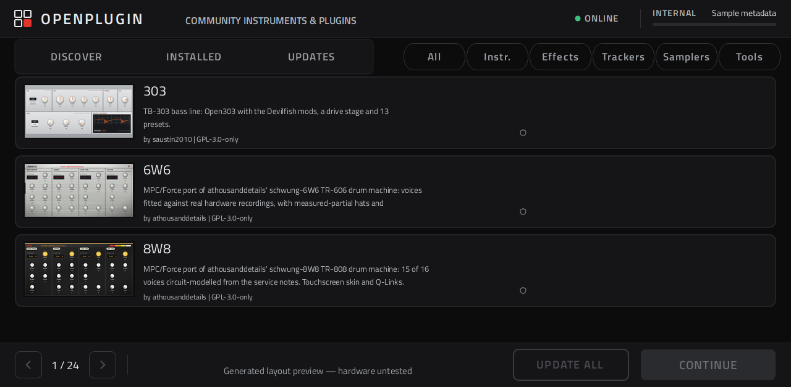

# OpenPlugin

Browse, install and update **community VST plugins on Akai Force 3.10.0 and MPC Gen1**, directly from the touchscreen. OpenPlugin also brings combined JV-880 ROM/plugin setup, community USB mouse support and SSH/SFTP file transfers.

Built on [poloq’s Plugin Manager](https://github.com/poloq-instruments/mpc-vst-manager) and [sd88me’s MPC VST Plugins](https://github.com/sd88me/mpc-vst-plugins). Original authors retain their credits and licenses. This independent, non-commercial project is AI-assisted and unaffiliated with Akai or inMusic.

**[OpenPlugin 0.8.3 build information and USB guide](docs/DOWNLOADS.md).** After the initial update, load **PLUGINS → VST → Plugin Manager** on a plugin track.

[Browse plugins](https://magicstino.github.io/force-openplugin/#catalog) · [Find or publish a plugin](docs/DISCOVERY.md) · [Test status](docs/TESTING.md)

**Release status:** OpenPlugin 0.8.2 includes the current catalog and bundled thumbnails for Clif Tape, TinyFreaky, PulyTek and Magic Tape Echo. Clif Tape's registered thumbnail is confirmed on Force. Online artwork download/cache works, but display of unbundled images remains unresolved. Plugin binaries are installed separately through the manager. Container, filesystem, injected-file and thumbnail regression checks pass; full-image flash/boot and audio-load validation remain pending. MPC Gen1 is hardware untested.



## What it does

- Discover community instruments, effects, samplers, trackers and tools; filter by name, author or tag.
- Download compatible native packages, queue installs and updates, or remove managed plugins.
- Load the online index when the manager opens or **Refresh catalog** is pressed; keep a saved index offline.
- Display bundled artwork immediately; download and cache compact online thumbnails for unbundled entries. Refresh catalog to retry missing artwork; cached thumbnails remain available offline.
- Prepare **JV-880 ROMs + plugin** in one action. Save first: installation restarts the application.
- Add a community USB mouse pointer with click/drag and wheel support, subject to the display compatibility guard.
- Transfer samples and files using **REMOTE ACCESS** SSH/SFTP controls. See the [connection guide](docs/SSH.md) for setup and test limits.

Only compatible ARMv7 community packages can be installed. General web pages, desktop VST bundles and source repositories alone are not installable packages. Refreshing the index does not install software automatically.

For existing 3.10.0 users, a same-version update prompt is expected: the original application remains **3.10.0.49**. See the [USB guide](docs/DOWNLOADS.md).

## Build from original firmware

Linux prerequisites: Python 3.12+, git, gcc, e2fsprogs, binutils, OpenSSH tools,
Chromium runtime libraries, several GB of RAM and approximately 5 GB of space.
The owner already supplied both original stock **3.10.0** firmware images for
this project: `Force-3.10.0-update.img` and `MPC-3.10.0-Gen1-update.img`.
Their exact SHA256 checksums are recorded in [inputs.json](inputs.json).
They are not stored in Git; use those supplied local files, or matching original
copies. Other firmware versions are rejected; renaming them does not help.

For this release, download and extract **OpenPlugin-0.8.2-source.zip** from the [0.8.2 release](https://github.com/MagicStino/force-openplugin/releases/tag/v0.8.3). This attached archive contains the complete build changes; GitHub's automatic source archives do not. Place the original images in a `firmware/` folder inside the extracted source, then run the commands below there.

Build **Force only**; no MPC image is required:

```sh
bash build.sh --device force firmware/Force-3.10.0-update.img output-force
```

Build **MPC Gen1 only**; no Force image is required:

```sh
bash build.sh --device mpc-gen1 firmware/MPC-3.10.0-Gen1-update.img output-mpc
```

Or build **both**:

```sh
bash build.sh firmware/Force-3.10.0-update.img \
  firmware/MPC-3.10.0-Gen1-update.img output
```

Each command builds the native payload and runs the same validation checks;
only the requested firmware image(s) are generated. The originals remain unchanged.
An optional final argument supplies an owner's public SSH key.

Outputs: `*-openplugin-v0.8.3-update.img`, checksums and validation manifests. Existing files
are not overwritten. The script fetches pinned dependencies and builds the
native code, artwork and selected images without mounting them. It does not flash.

Container version: **3.10.0-openplugin-v0.8.3**. The supplied 3.10.0 files
contain application **3.10.0.49**; its binaries and numeric version fields stay
unchanged. See [current build availability](docs/DOWNLOADS.md). Firmware images are distributed separately from Git source.

## Documentation

| Need | Read |
|---|---|
| Find plugins or list your project | [Discovery](docs/DISCOVERY.md) |
| Package a native plugin | [Package contract](docs/SOURCES.md) |
| Understand catalog/network behavior | [Indexing](docs/INDEXING.md) |
| Inspect image and firmware changes | [Integration](docs/INTEGRATION.md) |
| Check what was actually tested | [Validation](docs/TESTING.md) |
| Understand purpose and rights | [Research](docs/RESEARCH.md) |

Package installers run with device privileges and are not transactional.
Desktop VSTs, arbitrary websites and sample editors are not native packages.
Hakai compatibility must be assessed per package. MPC Sample is a separate
kit editor; kit import is not implemented here.

Existing component licenses apply; see [NOTICE](native/NOTICE.md).

## Real Force photos

[View the owner-supplied hardware gallery](https://magicstino.github.io/force-openplugin/#force-gallery): catalog, combined JV-880 setup, plugin selection and plugin interfaces. MPC imagery is labelled as a rendered preview.

## Community credits

Mouse source: [no3z, Amit Talwar and bonsaipanda](https://github.com/bonsaipanda/MPC-Force-SSH-Firmwares). Image decoding: [stb](https://github.com/nothings/stb). Pinned sources and licenses are preserved in `native/`.

**sd88me**: [MPC VST Plugins](https://github.com/sd88me/mpc-vst-plugins), the upstream catalog JSON and collection, and the native wrapper/skin/build tooling used here. Individual plugin authors and their upstream engines, ports, screenshots and artwork retain their credits and licenses.

**poloq-instruments**: [Plugin Manager](https://github.com/poloq-instruments/mpc-vst-manager), the native manager foundation, including existing device-side installation. Our additions integrate it into the firmware, add illustrated cards/search improvements, a scheduled catalog bridge, saved-catalog fallback and combined JV setup.

## Community catalog contributions

[Suggest a plugin](https://github.com/MagicStino/force-openplugin/issues/new?template=plugin-submission.yml), support an existing proposal with 👍, or [volunteer as a maintainer](https://github.com/MagicStino/force-openplugin/issues/new?template=maintainer-application.yml). [Community review guide](docs/COMMUNITY-CATALOG.md) explains the maintainer acceptance action, review pull requests and GitHub notifications. Submissions never enable installers automatically.

## Repository maintenance

For catalog refreshes, use the [update-plugins skill/runbook](.agents/skills/update-plugins/SKILL.md): commands, validation and removal review, commit/push, and GitHub Pages verification.

The 0.8.2 catalog includes Magic Tape Echo 0.1.1 (three-head artwork), PulyTek 1.0.2 and TinyFreaky 0.4.1. The last 3.9.1 firmware remains available as [v0.8.1-rc2](https://github.com/MagicStino/force-openplugin/releases/tag/v0.8.1-rc2).
