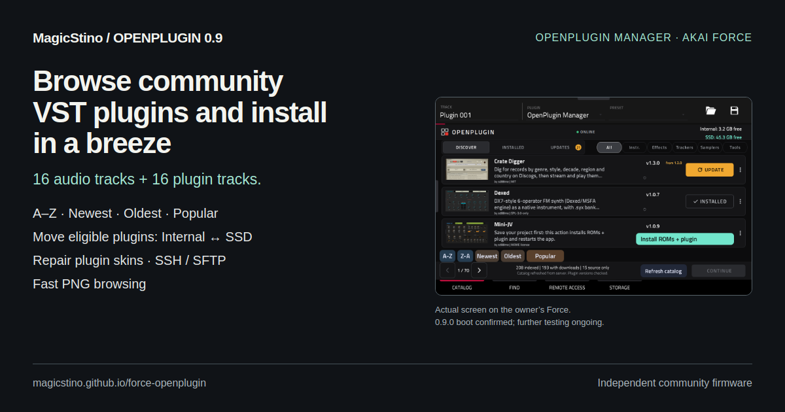
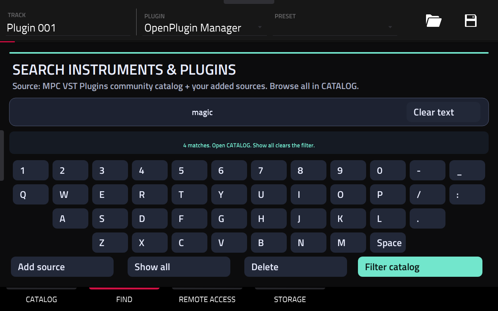

# OpenPlugin

Browse, install and update **community VST plugins on Akai Force 3.10.0 and MPC Gen1**, directly from the touchscreen. OpenPlugin also brings combined JV-880 ROM/plugin setup, community USB mouse support and SSH/SFTP file transfers.

Built on [poloq’s Plugin Manager](https://github.com/poloq-instruments/mpc-vst-manager) and [sd88me’s MPC VST Plugins](https://github.com/open-mpc/mpc-vst-plugins). Original authors retain their credits and licenses. This independent, non-commercial project is AI-assisted and unaffiliated with Akai or inMusic.

**[OpenPlugin 0.9.0 release notes](docs/RELEASE-0.9.0.md) · [User manual](docs/GUIDE.md) · [Downloads](docs/DOWNLOADS.md).** After the initial update, load **PLUGINS → VST → OpenPlugin Manager** on a plugin track.

[Browse plugins](https://magicstino.github.io/force-openplugin/#catalog) · [Find or publish a plugin](docs/DISCOVERY.md) · [Test status](docs/TESTING.md)

**Release status:** The current OpenPlugin 0.9.0 images with Tracks16 are available in the [downloads](docs/DOWNLOADS.md). Force owner testing confirms creation, saving and loading of 15 audio plus 15 plugin tracks, playback and rejection of a 17th track. Recording remains untested. MPC Gen1 passes software validation but remains hardware untested. Both images pass Akai ARM verification, filesystem, injected-file and SHA256 checks. The catalog snapshot contains 200 entries and 195 images; incompatible Gen2 downloads are blocked.

[](https://magicstino.github.io/force-openplugin/)

### Find your next plugin

Search by name or keyword, filter the catalog, and sort by A–Z, Newest, Oldest or Popular.



## OpenPlugin Manager 0.9.0 — 6 November 2026

The Force and MPC Gen1 0.9.0 images include fast PNG browsing, sorting, managed drive moves, skin repair and an ABOUT page. The manager has been exercised on the owner’s Force; the 0.9.0 image has now flashed and booted successfully, with ABOUT confirmed on the device. Storage across reboot, audio and track-limit checks on this image remain pending. [What changed](docs/RELEASE-0.9.0.md).

## Tracks16 release — 5 November 2026

The current complete images include **16 audio + 16 plugin tracks**, alongside Plugin Manager and SSH. [Patch details and validation](docs/TRACKS16.md).

## What it does

- Discover community instruments, effects, samplers, trackers and tools; filter by name, author or tag.
- Download compatible native packages, queue installs and updates, or remove managed plugins.
- Load the online index when the manager opens or **Refresh catalog** is pressed; keep a saved index offline.
- Load bundled PNG artwork quickly, with a gradient for missing images. Refresh updates catalog metadata; artwork updates ship with the manager.
- Sort A–Z, Z–A, Newest, Oldest or Popular; jump and refine by alphabet with matching paginator pages.
- Move eligible managed plugins from Internal to SSD/USB/SD and back, verify before cleanup, and keep missing-drive recovery guidance visible.
- Repair skin registrations automatically after installs or manually in STORAGE.
- Read the version, repository link and community credits in ABOUT.
- Prepare **JV-880 ROMs + plugin** in one action. Save first: installation restarts the application.
- Add a community USB mouse pointer with click/drag and wheel support, subject to the display compatibility guard.
- Transfer samples and files using **REMOTE ACCESS** SSH/SFTP controls. See the [connection guide](docs/SSH.md) for setup and test limits.

Only compatible ARMv7 community packages can be installed. General web pages, desktop VST bundles and source repositories alone are not installable packages. Refreshing the index does not install software automatically.

For existing 3.10.0 users, a same-version update prompt is expected: the original application remains **3.10.0.49**. See the [USB guide](docs/DOWNLOADS.md).

## Current Open MPC build — 4 November 2026

The local 4 November 2026 work restores the complete 3.10.0 build source,
refreshes 200 catalog entries and 195 locked images, and blocks Gen2/AArch64
packages in both the bridge and native manager. These files are distinct
from the older 0.8.3 release. The owner accepted the Force build on hardware;
MPC Gen1 remains hardware untested.
See [local build details](docs/LOCAL-BUILD-2026-11-04.md).

## Build from original firmware

Linux prerequisites: Python 3.12+, git, gcc, e2fsprogs, binutils, OpenSSH tools,
Chromium runtime libraries, several GB of RAM and approximately 5 GB of space.
The owner already supplied both original stock **3.10.0** firmware images for
this project: `Force-3.10.0-update.img` and `MPC-3.10.0-Gen1-update.img`.
Their exact SHA256 checksums are recorded in [inputs.json](inputs.json).
They are not stored in Git; use those supplied local files, or matching original
copies. Other firmware versions are rejected; renaming them does not help.

This checkout includes the 3.10.0 build code restored from the checksum-verified
0.8.3 release source, together with the current Open MPC catalog integration.
Place the original images in `firmware/`, or pass their existing absolute paths.

Build **Force only**; no MPC image is required:

```sh
bash build.sh --device force firmware/Force-3.10.0-update.img output-force
```

Build **MPC Gen1 only**; no Force image is required:

```sh
bash build.sh --device mpc-gen1 firmware/MPC-3.10.0-Gen1-update.img output-mpc
```

Or build **both**:

```sh
bash build.sh firmware/Force-3.10.0-update.img \
  firmware/MPC-3.10.0-Gen1-update.img output
```

Each command builds the native payload and runs the same validation checks;
only the requested firmware image(s) are generated. The originals remain unchanged.
An optional final argument supplies an owner's public SSH key.

Outputs: `*-openplugin-v0.9.0-update.img`, checksums and validation manifests. Existing files
are not overwritten. The script fetches pinned dependencies and builds the
native code, artwork and selected images without mounting them. It does not flash.

Container version: **3.10.0-openplugin-v0.9.0**. The supplied 3.10.0 files
contain application **3.10.0.49**; its binaries and numeric version fields stay
unchanged. See [current build availability](docs/DOWNLOADS.md). Firmware images are distributed separately from Git source.

## Documentation

| Need | Read |
|---|---|
| Find plugins or list your project | [Discovery](docs/DISCOVERY.md) |
| Package a native plugin | [Package contract](docs/SOURCES.md) |
| Understand catalog/network behavior | [Indexing](docs/INDEXING.md) |
| Inspect image and firmware changes | [Integration](docs/INTEGRATION.md) |
| Check what was actually tested | [Validation](docs/TESTING.md) |
| Understand purpose and rights | [Research](docs/RESEARCH.md) |

Package installers run with device privileges and are not transactional.
Desktop VSTs, arbitrary websites and sample editors are not native packages.
Hakai compatibility must be assessed per package. MPC Sample is a separate
kit editor; kit import is not implemented here.

Existing component licenses apply; see [NOTICE](native/NOTICE.md).

## Real Force photos

[View the owner-supplied hardware gallery](https://magicstino.github.io/force-openplugin/#force-gallery): catalog, combined JV-880 setup, plugin selection and plugin interfaces. MPC imagery is labelled as a rendered preview.

## Community credits

**NoQuestion & dustyslices**: first documented the VST method in the MPC-Forums thread [“Proof of Concept: Custom Standalone Plugins”](https://www.mpc-forums.com/viewtopic.php?f=41&t=220981) (September 2026), as credited by [Open MPC](https://github.com/open-mpc/mpc-vst-plugins#credits).

**MockbaTheBorg / MockbaMod**: [SSH, screen and mouse information and community code](https://github.com/MockbaTheBorg/MockbaMod) that informed our remote-access and testing work. The bundled mouse code is separately credited to [no3z, Amit Talwar and bonsaipanda](https://github.com/bonsaipanda/MPC-Force-SSH-Firmwares); its original license and source attribution are preserved.

Mouse source: [no3z, Amit Talwar and bonsaipanda](https://github.com/bonsaipanda/MPC-Force-SSH-Firmwares). Image decoding: [stb](https://github.com/nothings/stb). Pinned sources and licenses are preserved in `native/`.

**sd88me**: [MPC VST Plugins](https://github.com/open-mpc/mpc-vst-plugins), the catalog setup, upstream catalog JSON and collection, and the native wrapper/skin/build tooling used here. Individual plugin authors and their upstream engines, ports, screenshots and artwork retain their credits and licenses.

**poloq-instruments**: [Plugin Manager](https://github.com/poloq-instruments/mpc-vst-manager), the native manager foundation, including existing device-side installation. Our additions integrate it into the firmware, add illustrated cards/search improvements, a scheduled catalog bridge, saved-catalog fallback and combined JV setup.

## Community catalog contributions

[Suggest a plugin](https://github.com/MagicStino/force-openplugin/issues/new?template=plugin-submission.yml), support an existing proposal with 👍, or [volunteer as a maintainer](https://github.com/MagicStino/force-openplugin/issues/new?template=maintainer-application.yml). [Community review guide](docs/COMMUNITY-CATALOG.md) explains the maintainer acceptance action, review pull requests and GitHub notifications. Submissions never enable installers automatically.

## Repository maintenance

For catalog refreshes, use the [update-plugins skill/runbook](.agents/skills/update-plugins/SKILL.md): commands, validation and removal review, commit/push, and GitHub Pages verification.

The 0.8.2 catalog includes Magic Tape Echo 0.1.1 (three-head artwork), PulyTek 1.0.2 and TinyFreaky 0.4.1. The last 3.9.1 firmware remains available as [v0.8.1-rc2](https://github.com/MagicStino/force-openplugin/releases/tag/v0.8.1-rc2).
