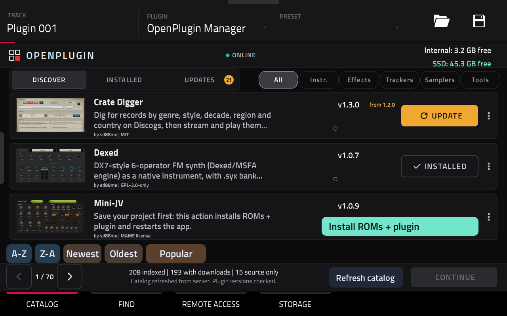
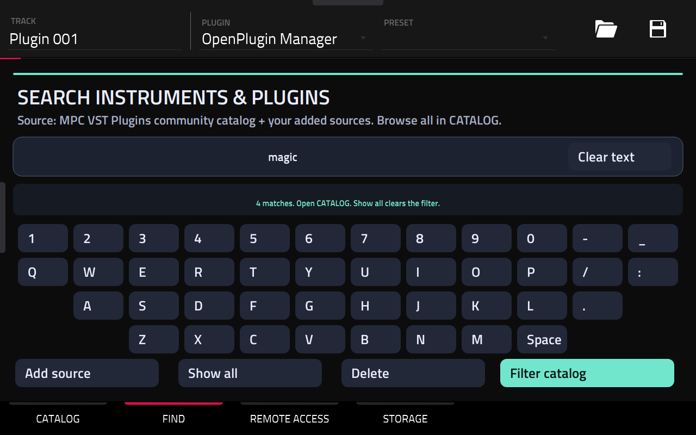
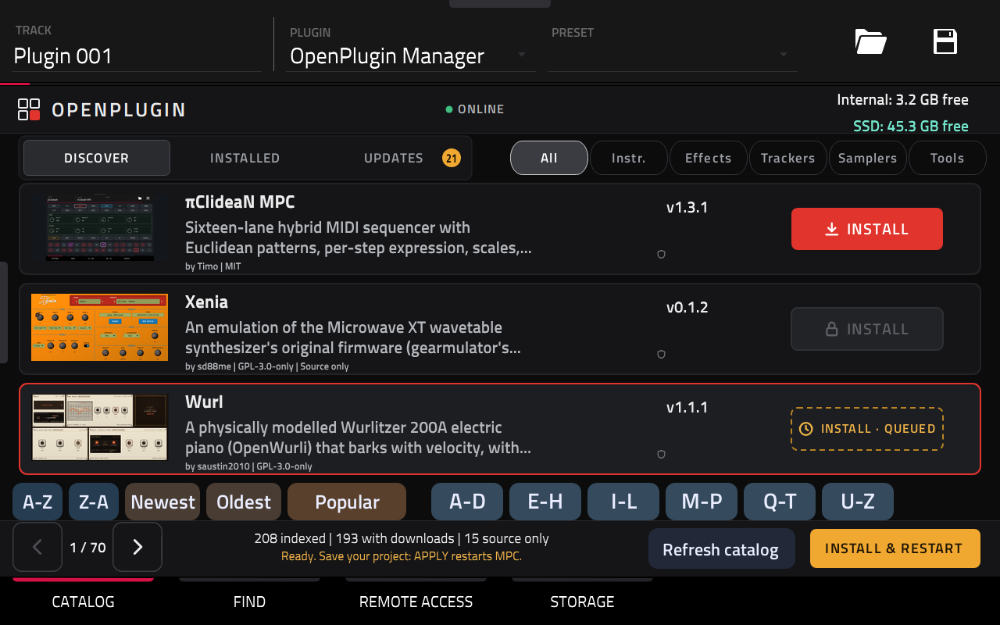
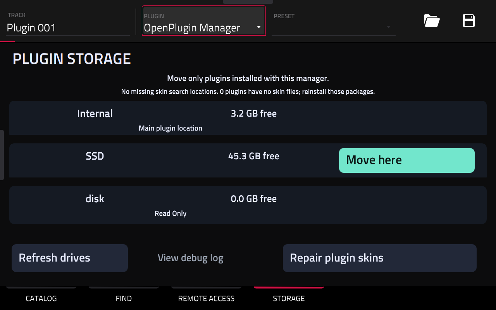
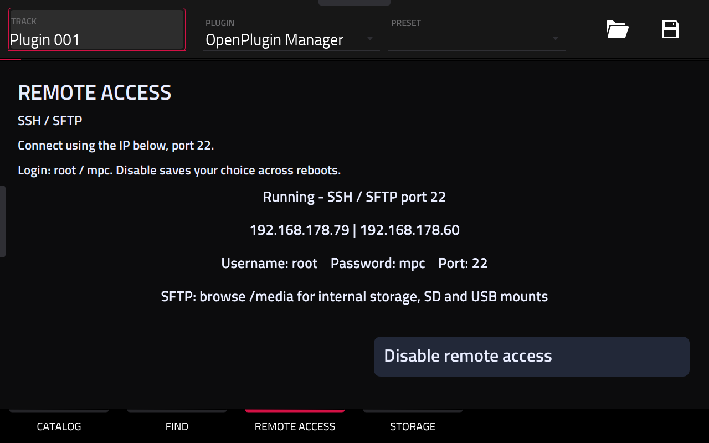
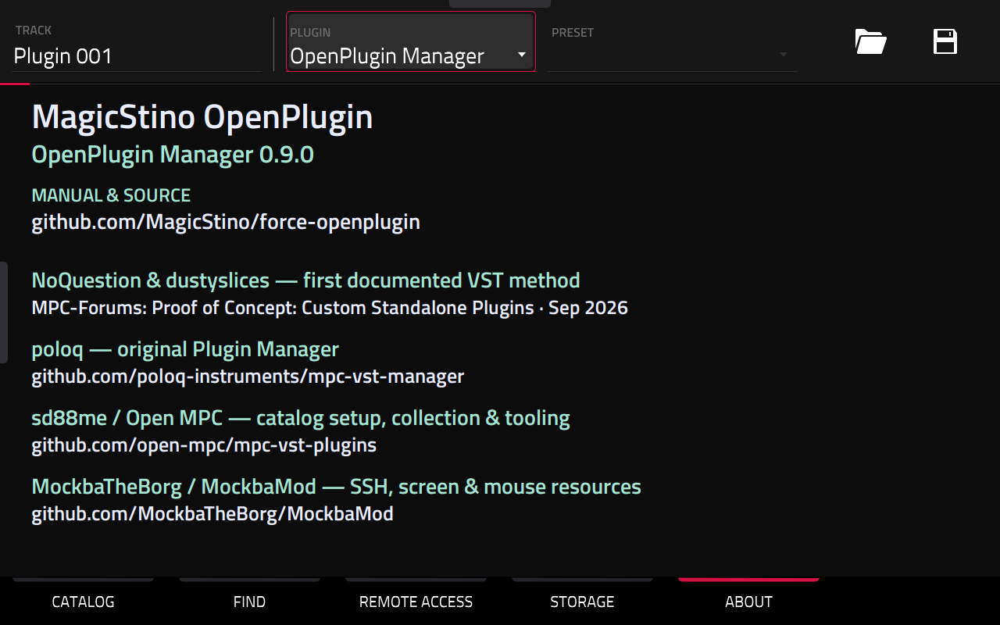

# MagicStino OpenPlugin — user guide

OpenPlugin Manager **0.9.0** for Akai Force, built on firmware 3.10.0.

[GitHub source and updates](https://github.com/MagicStino/force-openplugin) · [Online guide](https://magicstino.github.io/force-openplugin/#guide)

## Open the manager

Create a plugin track and choose **PLUGINS → VST → OpenPlugin Manager**. Its leading space keeps it near the top of the list. The ABOUT tab shows the version, repository link and community credits. The repository links to this manual.

## Find the right plugin

- **A–Z / Z–A:** alphabetical order. Tap a letter group to jump immediately, then refine to a letter. The paginator follows the selected letter. Back returns to the groups.
- **Newest / Oldest:** latest plugin update date, falling back to its compatible release date. Undated plugins stay last.
- **Popular:** highest download totals reported by the upstream catalog first. This does not count your personal installs.
- Alphabet controls hide while date or popularity sorting is selected.
- Use the instrument/effect/category filters, or FIND to search names, authors, descriptions and tags.
- **Refresh catalog** updates the index and package versions. It does not install anything. A saved catalog remains available offline.

Normal bundled PNG artwork replaces the former thousands of image controls. Startup was dramatically faster in owner testing; exact timing depends on the device and network. Missing artwork uses a simple gradient. Refresh updates catalog data, not bundled artwork.

## Install and update

Select Install or Update, then Continue. Follow the preparation and confirmation screens. Save your project before the final install/restart action. Use the manager's restart action to apply prepared changes; rebooting manually does not complete a queue.

Mini-JV / JV-880 has a combined ROM and plugin setup flow. Existing package and ROM requirements still apply.

## Move managed plugins to SSD — or back to Internal

Open **STORAGE**. Drive checks run when Storage is opened, with progress shown. Rows show Internal and connected drives, their free space, and the current main plugin location. Refresh drives after connecting a device.

1. Save your project. Finish or clear queued installs, updates or removals first. While changes are pending, Move here is greyed out and Storage explains the next step.
2. Choose **Move here** on a viable SSD, USB drive or SD card. The manager checks ownership, files, destination and free space.
3. Review the move, then choose **Move & restart**. Progress shows checking, copying and verification.
4. Verified moves update plugin registration and the manager's install destination. Eligible source copies are removed after success to free Internal space.
5. To move back, select Internal and confirm the return. The owner tested Internal → SSD → Internal successfully.

Only plugins owned by this manager are moved. Other plugins are untouched. Packages that require unsupported symbolic links stay on Internal. Plugin content and ROMs inside an eligible package move with it; external or hard-coded content paths can prevent a safe move. Arbitrary third-party plugins are not guaranteed movable.

The 0.9.0 image includes startup support for the manager's executable plugin folders on supported drives. It does not remount the entire drive. This replaces the temporary startup support used during development tests. Full-image reboot testing is still required before claiming release acceptance.

If a drive containing moved plugins is missing, reconnect it. Then move those plugins elsewhere before removing a frequently unplugged drive. An unavailable or nearly full card can remain visible without a usable move action.

## Repair plugin skins

Choose **Repair plugin skins** in Storage if a plugin opens without its intended interface. It checks the managed plugin locations and can repair missing skin search registrations. Successful manager installs also maintain skin registrations. Missing skin files require reinstalling the affected package; a path repair cannot recreate absent files. Follow the displayed confirmation and restart steps.

## SSH and SFTP

REMOTE ACCESS shows the IP address, port and login hint. The shared-password build uses username **root**, password **mpc**, port **22**. Choose SFTP in a file-transfer app. Enable/disable is stored across restarts. Use a trusted network. The full-image persistence path remains part of release acceptance testing.

## About, support and credits

**NoQuestion & dustyslices**: first documented the VST method in the MPC-Forums thread [“Proof of Concept: Custom Standalone Plugins”](https://www.mpc-forums.com/viewtopic.php?f=41&t=220981) (September 2026), as credited by [Open MPC](https://github.com/open-mpc/mpc-vst-plugins#credits).

**MagicStino OpenPlugin · OpenPlugin Manager 0.9.0**

[Manual](https://github.com/MagicStino/force-openplugin/blob/main/docs/GUIDE.md) · [Source](https://github.com/MagicStino/force-openplugin) · [Report an issue](https://github.com/MagicStino/force-openplugin/issues)

For failures, photograph the message and Storage's compact debug log. Include manager version, action and drive. The log focuses on critical events and errors.

Built on [poloq’s original Plugin Manager](https://github.com/poloq-instruments/mpc-vst-manager) and [Open MPC tools by sd88me and the community](https://github.com/open-mpc/mpc-vst-plugins), with the [Open MPC catalog](https://open-mpc.github.io/). Individual plugins and screenshots remain credited to their authors. Independent community project, unaffiliated with Akai or inMusic.

**MockbaTheBorg / MockbaMod**: [SSH, screen and mouse information and community code](https://github.com/MockbaTheBorg/MockbaMod) that informed our remote-access and testing work. The bundled mouse code is separately credited to [no3z, Amit Talwar and bonsaipanda](https://github.com/bonsaipanda/MPC-Force-SSH-Firmwares); its original license and source attribution are preserved.

